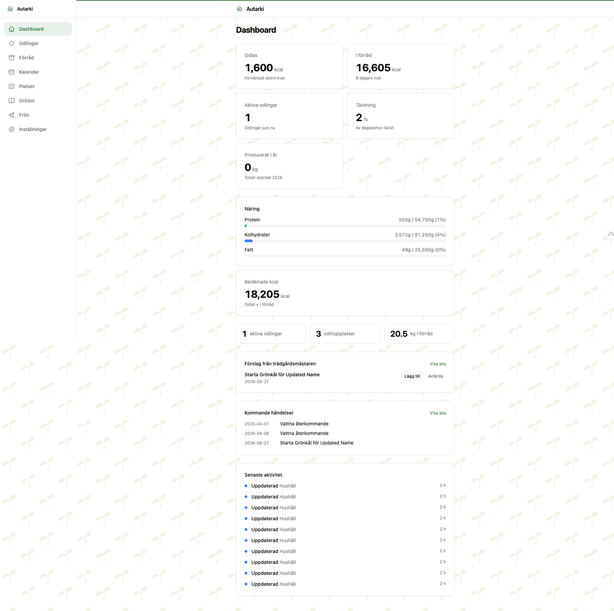
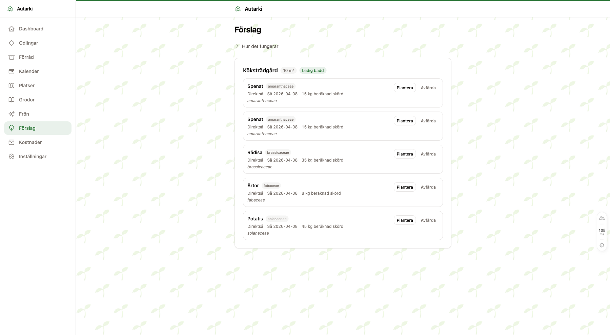

# Autarki

> Plan, plant, and track your way to self-sufficiency.

Autarki is a planner and calculator for **urban gardeners and small-plot hobbyists** who want to grow more of their own food. The app tracks how close you actually are to feeding yourself, suggests what to plant next, and helps you manage multiple crops and beds in a smart way — calorie and macro accounting, shelf-life-aware storage, succession planting, and a visual garden grid, all from a single self-hosted PWA.

The name _Autarki_ (Swedish, from Greek _autárkeia_) means self-sufficiency — independence from outside supply. It's most often used in economic terms, for nations independent of foreign trade; here it scales straight down to a backyard.



## What it does

- **Plantings** — log what's in the ground per bed (or as indoor seedlings), mark harvested, see expected vs actual yield
- **Photo journal** — per-planting photo log + hero photo per growing location, with EXIF date preserved
- **Storage with shelf-life** — every batch carries an expiry date; the app surfaces what's about to spoil
- **Self-sufficiency model** — declare how much of each crop you want to eat (kg/week and/or kg/year), see per-crop coverage with a stacked storage + expected-yield bar
- **Succession-planting suggestions** — bed-aware, rotation-aware, sow-window-aware, companion-aware, frost-gate-aware, ranked by your demand gaps
- **Smart frost gate** — SAFE / STRETCH / IMPOSSIBLE classification with actionable advice ("kräver fiberduk vid frostnatt") instead of silent drops
- **Family rotation** — per-family hard exclusions (clubroot, Verticillium) + legume-predecessor bonuses, sourced from Jordbruksverket / RHS / Cornell / NC State
- **Indoor seedling lifecycle** — engine suggests when/where to transplant; calendar derives harden-off + transplant chores from the accepted plan
- **Garden chores** — typed events (watering, fertilizing, pruning, weeding, pest-checks) with RFC-5545 recurring rules, "last done" per location, filterable timeline
- **Visual garden planner** — paint your garden grid, tag beds, multi-touch pan + pinch-zoom, deferred-commit selection
- **Cost tracking** — log expenses per crop or location to measure real ROI
- **Calorie + macro accounting** — Nordic-sourced nutrition data turned into a real "% of household need covered" _(being phased out in favour of the per-crop coverage model)_
- **Calendar** — upcoming harvests + chores grouped by urgency, multi-bed / multi-planting tagging
- **Households** — log in with Pocket ID; every account gets its own household, invite others with a link, belong to several households and switch between them
- **Bilingual** — Swedish and English
- **PWA** — installable as a home-screen app, mobile-first



## Tech Stack

| Layer           | Choice                                |
| --------------- | ------------------------------------- |
| Server          | Hono + `@homelab/server-kit` (sign-in) |
| Client          | React + Vite on `@homelab/ui` (Skymning theme) |
| Language        | TypeScript (strict)                   |
| Styling         | Tailwind CSS, colours from tokens only |
| Database        | SQLite (better-sqlite3) + Drizzle ORM, migrations in `drizzle/` |
| i18n            | `@homelab/i18n` (sv, en)              |
| PWA             | vite-plugin-pwa                       |
| Unit Testing    | Vitest                                |
| E2E Testing     | Playwright                            |
| Linting         | ESLint (the suite config)             |
| Package Manager | npm (app-suite workspace)             |
| Hosting         | Docker (homelab)                      |

## Development

Part of the [app-suite](../../README.md) monorepo. From the repo root:

```bash
npm install
npm run dev:garden   # API on :3500, client on http://localhost:4200 (proxies /api/ to the API)
```

The server is in `src/server` like the other apps: `app.ts` wires the routes in `routes/` (thin: validate, call a service, return the result), business logic lives in `services/`, and the schema in `db/schema.ts`. After changing the schema run `npm run db:generate -w apps/garden` and commit the new migration. The client is in `src/client` like the other apps: a page per route in `pages/`, shared pieces in `components/`, pure logic (canvas maths, recurrence, yield) in `lib/` with unit tests, and the canvas itself in `hooks/useGardenCanvas.ts`. `npm run test:coverage` holds an 80% floor on services, utils and `src/client/lib`.

**Household scoping.** `householdMiddleware` (`src/server/context.ts`) runs before every `/api` route past sign-in: it puts the active household on the context and answers 404 for any id that belongs to another household. It checks the id after `/api/<entity>/` plus `householdId`, `locationId`, `targetLocationId`, `plantingId`, `locationIds` and `plantingIds` in the query and JSON body. So a new household-owned table or route entity goes into `SCOPED_ENTITIES` (`utils/scope-refs.ts`) and `ScopeService`, a new body field pointing at a household's rows into `FIELD_ENTITIES`, list endpoints without a `householdId` filter by `requireHousehold(c).id` themselves, and owner-only actions call `requireOwner(c)`.

```bash
npm test -w apps/garden                 # unit + integration (Vitest)
npm run test:coverage -w apps/garden    # same, with the 80% coverage gate
npm run test:e2e -w apps/garden         # full e2e suite (Playwright; with CI=true it runs the built server, so `npm run build -w apps/garden` first)
npm run test:e2e:smoke -w apps/garden   # critical-path subset tagged @smoke
npm run check                           # typecheck + lint + tests for every app
```

## CI/CD

app-suite's CI runs `npm run check` for every app. The coverage gate and Playwright e2e run locally (`npm run test:coverage`, and `npm run test:e2e` against the built server with `CI=true`). On push to `main` it builds `ghcr.io/<owner>/garden` when garden or a shared file changed (`:latest` and `:sha-…`; a `garden-v1.2.3` tag also publishes `:1.2.3`).

## Deployment

See [compose.example.yml](./compose.example.yml). The image stores its SQLite database at `/data/app.db` (mount `./data:/data`) and listens on port 3000.

### Login and households

Login goes through [Pocket ID](https://pocket-id.org) over OIDC, shared with the other apps via `createAuth` in server-kit (`AUTH_MODE=oidc` plus `PUBLIC_URL`, `SESSION_SECRET`, `OIDC_ISSUER`, `OIDC_CLIENT_ID`, `OIDC_CLIENT_SECRET`; see [.env.example](./.env.example)). Create an OIDC client in Pocket ID with the callback URL `https://<your host>/api/auth/callback`.

- Every account gets its own household on first login and owns it.
- **Settings → Members** has the household's invite link. Anyone who opens it and logs in joins that household; if it is their first login they only join it and get no empty household of their own.
- Members can edit everything. Only the owner can change the invite link, remove members, reset data or delete the household.
- A user in several households switches between them in the header.
- Crops, seed varieties and macro presets are shared by everyone; everything else (beds, plantings, storage, events, expenses, activity log, …) belongs to one household.

`AUTH_MODE=dev` skips login and runs everything as a fixed "Dev User". It is the default for `npm run dev:garden` and is what the e2e tests use.

> ⚠️ Some features rely on browser APIs that require HTTPS (e.g. geolocation for the growing-zone detector) and won't work over plain HTTP. Put the container behind something that terminates TLS (Cloudflare Tunnel, Caddy, …).

## Data Sources

Crop nutrition values (kcal, protein, carbs, fat per kg of fresh produce) are sourced from **Livsmedelsverket** (Swedish Food Agency):

- Database: [Sök näringsinnehåll](https://soknaringsinnehall.livsmedelsverket.se/)
- API: [Livsmedelsverket Open Data](https://dataportal.livsmedelsverket.se/livsmedel/swagger/index.html)

Each crop in `src/server/db/seed-data.ts` references its SLV item number. Grains use whole-grain flour as the closest available entry.

## Roadmap

See [BACKLOG.md](./BACKLOG.md) for what's coming next.

## Acknowledgements

- [Livsmedelsverket](https://www.livsmedelsverket.se/) — open nutrition data for every seeded crop
- [React](https://react.dev/) and [Vite](https://vite.dev/) — the client
- [Hono](https://hono.dev/) — the API server
- [Drizzle](https://orm.drizzle.team/) — typesafe SQL without the ORM tax

## License

MIT — see [LICENSE](./LICENSE).
